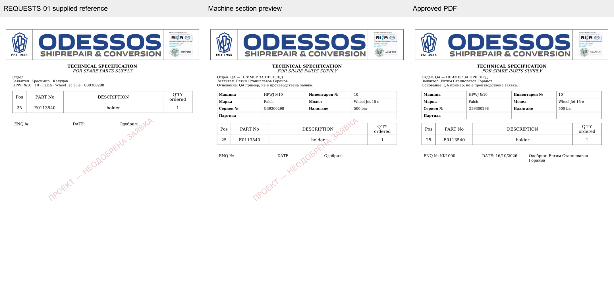
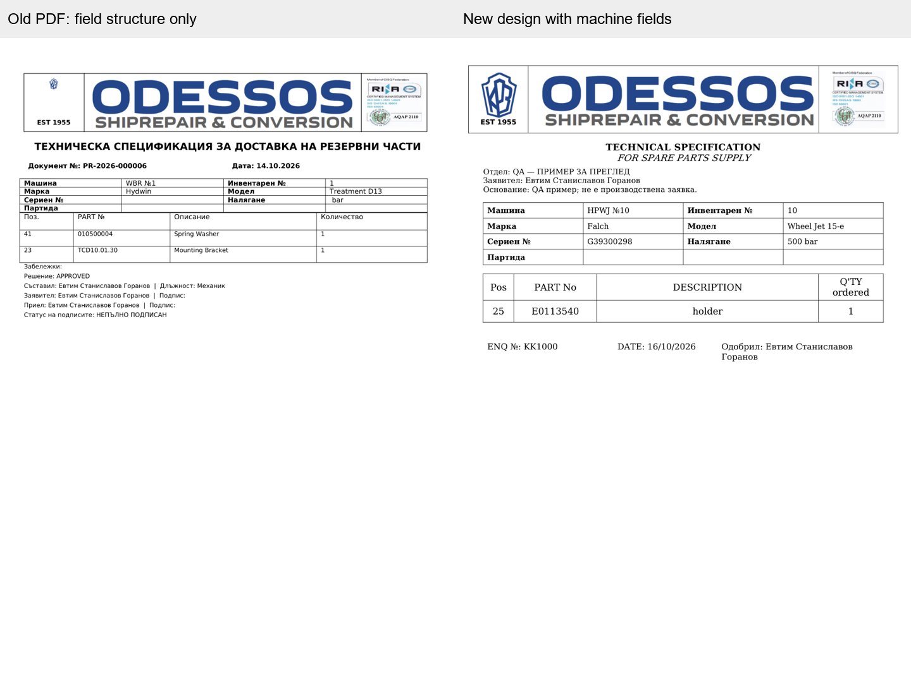

# REQUESTS-01 — машинна техническа таблица

Ново оформление само за бъдещи одобрения със свързана машина: общият генератор
добавя таблица 4 × 4 над резервните части и премахва обединения машинен ред.
Фирмената шапка, заглавието, основните шрифтове, таблицата с части, долният ред
и техническите приложения използват досегашния REQUESTS-01 layout.





## QA комплекти

Всички примери са създадени в еднократна SQLite тестова база. Няма запис в реална
база или регистрация на реална бизнес заявка. Надписите QA разграничават примерите.
Каталожният пример използва проверените seed данни за машина №10, Falch Wheel Jet
15-e, сериен № G39300298, 500 bar и част E0113540. Схемата и парт листата идват
от съществуващото проверено техническо доказателство.

| Комплект | Файлове | Страници |
|---|---|---|
| А — свободна заявка | `KK1000.pdf`, `KK1000.docx` | 1 във всеки формат |
| Б — каталожна заявка | `catalog-preview.pdf`, `catalog-KK1000.pdf`, `catalog-KK1000.docx` | 3 във всеки формат |

Файловете се експортират чрез CI artifacts `requests01-examples` и
`requests01-machine-layout`. PNG от одобрения каталожен документ:
[страница 1](catalog-KK1000-1.png), [схема](catalog-KK1000-2.png),
[парт листа](catalog-KK1000-3.png). Допълнително:
[предварителен PDF](catalog-preview-1.png), [свободна заявка](free-form-1.png).

Прегледани са всички страници на двата предоставени PDF образеца, двата одобрени
QA PDF документа, каталожния preview и рендерите на двата DOCX документа.
DOCX е рендериран и с каноничния `render_docx.py --emit_pdf`.
Тестовете отделно сравняват пикселите на архивирания PDF с независимо преобразуване
на архивирания DOCX през приложния конвертор: всички страници съвпадат.

## Неизменяемост и партида

- Новите snapshot-и с машина са layout version 3. Без машина остава version 2.
- Версии 1/2 запазват оригиналното си рендериране; няма upgrade на съществуващи
  snapshot-и. Готовата архивна двойка PDF/DOCX се връща със същите байтове и SHA-256.
- Машинните стойности и произходът на партидата се записват при одобряване.
  Retry използва тях, архивирания шаблон и фирмените ресурси.
- Моделът няма собствено поле за машинна партида. Допуска се само изрично
  операторско custom поле с код `batch_reference` (без значение от регистъра),
  активно и от категорията на машината. Запазват се ID и кодът на полето.
  При липса клетката остава празна. Партиди от предаване не се използват.
- Няма промени по схема, seed данни, контролирани ресурси, исторически файлове,
  KK брояч, права, доставки или логика за одобрение.

## Възпроизводими проверки

```text
python -m ruff check backend/app backend/alembic backend/scripts scripts tests
python -m pytest -q --tb=short --disable-warnings tests/test_request_machine_layout.py tests/test_requests01.py tests/test_requests01_migrations.py tests/test_part_request_visual_appendix.py tests/test_catalog_final_audit.py
python backend/scripts/requests01_document_smoke.py --output <disposable-QA-directory>
```

QA export тестовете се включват с `ASSETCORE_REQUESTS01_QA_OUTPUT` и
`ASSETCORE_MACHINE_LAYOUT_QA_OUTPUT`, ограничени до игнорираната `.tmp` директория.
Smoke проверката включва BG/EN/RU, 48 дълги реда на 9 страници за всеки език,
повторени заглавия и единичен ред на 3 страници, плюс машинна таблица на трите
езика с празен сериен номер/партида и налягане 0 bar.

Контролните хешове на двата оригинални образеца и QA файловете са в
[proof.json](proof.json). Оригиналните файлове са непроменени. Production не е
достъпван; няма deployment или merge.
